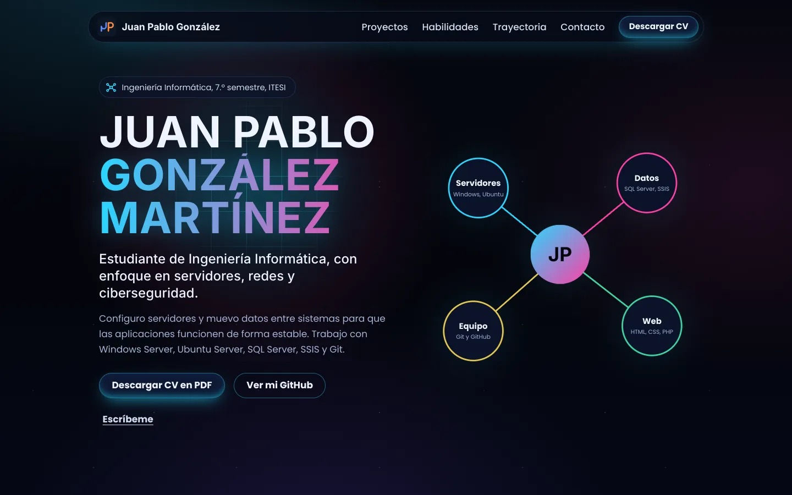
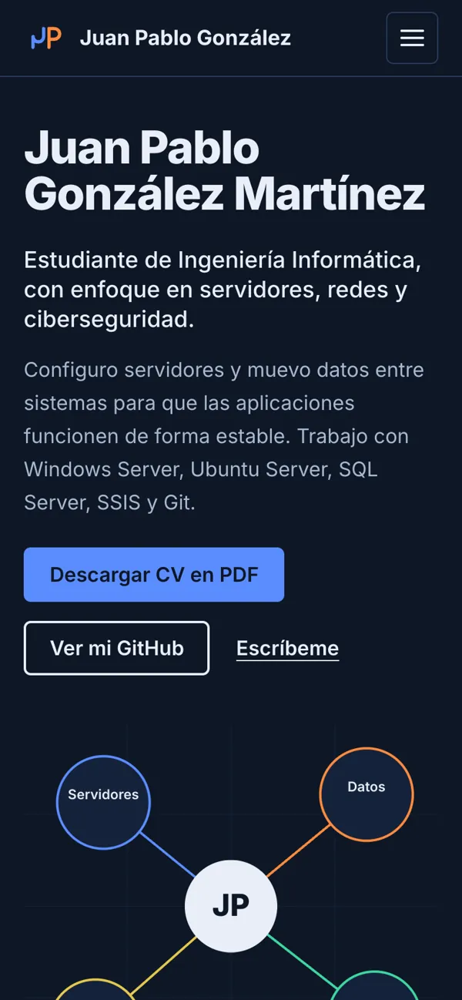
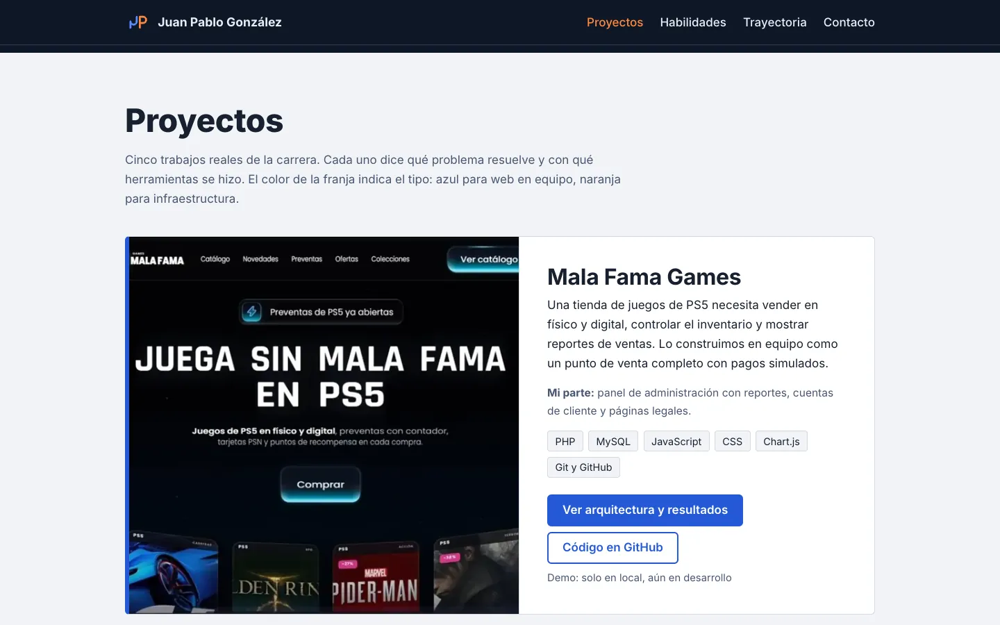
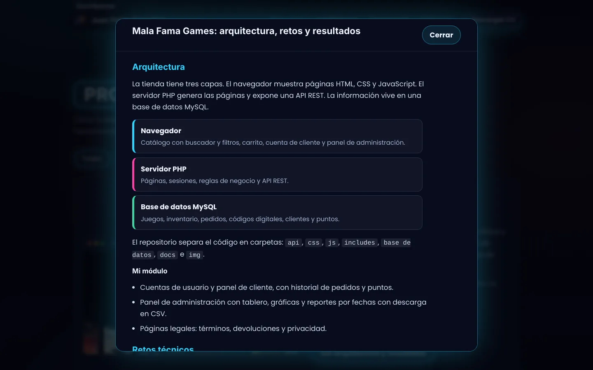
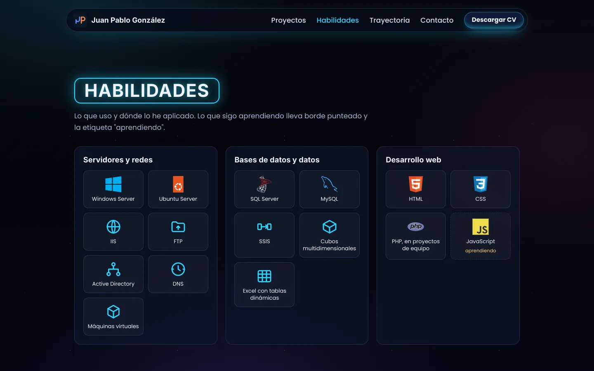

# Portafolio web de Juan Pablo González Martínez

Portafolio profesional individual de un estudiante de Ingeniería Informática del Instituto Tecnológico Superior de Irapuato (ITESI), con enfoque en servidores, redes y ciberseguridad. Es una carta de presentación técnica para reclutadores y clientes: presenta mis proyectos, mis habilidades, mi formación y un formulario de contacto.

**Sitio publicado:** https://JuanPablo814.github.io/NOMBRE-DEL-REPOSITORIO/ (reemplaza el nombre cuando publiques el sitio)

## Capturas de pantalla

| Inicio (escritorio) | Inicio (móvil) |
| --- | --- |
|  |  |

| Proyectos | Vista detallada de un proyecto |
| --- | --- |
|  |  |



## Secciones

- **Inicio:** nombre, especialización, propuesta de valor en dos líneas, botón para descargar el CV en PDF y enlaces a GitHub y contacto. Incluye un mapa interactivo de mis áreas de trabajo.
- **Proyectos:** cinco proyectos con filtros por tipo, captura o diagrama dentro de un marco de navegador, problema que resuelven, tecnologías, enlace al código y a la demo cuando existen. Mala Fama Games tiene una vista detallada (modal) con arquitectura, retos técnicos y resultados.
- **Habilidades:** clasificadas por área, con ícono por tecnología y sin barras de porcentaje. Lo que sigo aprendiendo está marcado con borde punteado.
- **Trayectoria y formación:** línea del tiempo académica, concursos, actividades y certificaciones.
- **Contacto:** formulario con validación en el cliente y enlaces a GitHub y correo.

## Tecnologías

- HTML5 semántico (`header`, `main`, `section`, `article`, `footer`, `dialog`)
- CSS3 con variables, Grid y Flexbox, diseño mobile-first y estilo neón oscuro
- JavaScript sin librerías: luz que sigue al mouse, animación al hacer scroll, tarjetas con inclinación, filtros de proyectos, vista detallada accesible, sección activa y validación del formulario
- Tipografías Chakra Petch y Poppins (Google Fonts)
- Íconos de tecnologías de [Devicon](https://devicon.dev/) (licencia MIT), guardados localmente en `assets/icons`, y íconos propios en SVG
- Imágenes en WebP y diagramas en SVG

## Estructura de carpetas

```
.
├── index.html
├── README.md
├── assets/
│   ├── icons/          Íconos de tecnologías (SVG)
│   └── img/            Capturas de proyectos (WebP), diagrama y favicon (SVG)
├── css/
│   └── styles.css
├── js/
│   └── main.js
└── docs/
    ├── CV-Juan-Pablo-Gonzalez-Martinez.pdf
    └── capturas/       Capturas usadas en este README
```

## Calidad, accesibilidad y rendimiento

- Diseño responsivo probado en 390 px, 820 px y 1440 px, sin desplazamiento horizontal.
- Enlace para saltar al contenido, foco visible, etiquetas en todos los campos y mensajes de error con `role="alert"`.
- Todas las imágenes tienen texto alternativo, ancho y alto definidos y carga diferida.
- Imágenes de proyectos en WebP de entre 20 y 45 KB cada una.
- Respeta la preferencia de movimiento reducido del sistema: sin animaciones de entrada ni inclinación.
- Los efectos del mouse solo se activan en dispositivos con mouse.
- Todo el CSS está limitado al contenedor `.jp`, para que no choque con otros portafolios si se juntan en un mismo sitio.
- No usa frameworks ni librerías externas de JavaScript.

## Cómo ejecutarlo en local

No necesita instalación. Abre `index.html` en el navegador, o sirve la carpeta con cualquier servidor estático:

```
python -m http.server 8000
```

Después visita http://localhost:8000.

## Cómo publicarlo en GitHub Pages

1. Sube el proyecto a un repositorio público de GitHub.
2. Entra a **Settings > Pages**.
3. En **Build and deployment**, elige **Deploy from a branch**, la rama `main` y la carpeta `/ (root)`.
4. Guarda. En unos minutos el sitio queda disponible en `https://JuanPablo814.github.io/NOMBRE-DEL-REPOSITORIO/`.

## Notas

- El formulario de contacto valida los datos en el navegador y abre la aplicación de correo del visitante con el mensaje ya escrito. Como el sitio es estático, no guarda mensajes en un servidor.
- Los proyectos que solo están en local se muestran con captura y la nota "Demo: solo en local".

## Autor

Juan Pablo González Martínez, estudiante de Ingeniería Informática en el ITESI, Irapuato, Guanajuato.
Correo: juanpgonzalez116@gmail.com · GitHub: https://github.com/JuanPablo814
